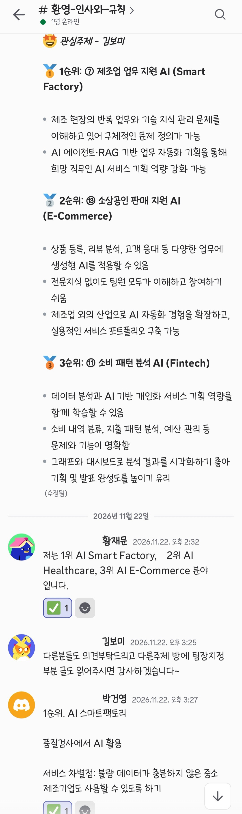
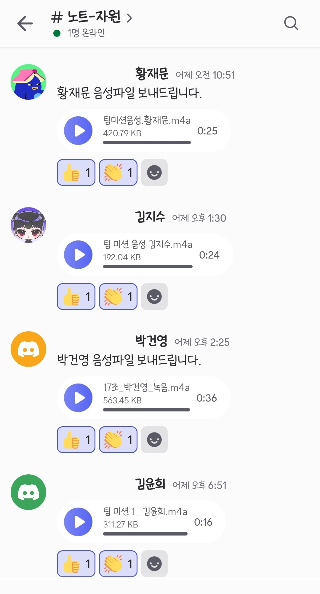

# 협업 기록

17조 팀원들이 디스코드 채널에서 함께 진행한 활동을 날짜순으로 정리했습니다. 원본 캡처는 이 폴더에 있습니다. (개인정보 보호를 위해 닉네임 앞부분은 가렸습니다.)

## 타임라인

| 일시 | 참여자 | 활동 | 결과물 반영 |
|---|---|---|---|
| 2026.11.22 | 김보미 | 7개 도메인 아이디어와 관심 주제 1~3순위 공유, 팀원 의견 요청 | 주제 선정 투표 시작 |
| 2026.11.22 14:32 | 황재문 | 관심 분야 투표: 1위 AI Smart Factory, 2위 AI Healthcare, 3위 AI E-Commerce | 도메인 집계 |
| 2026.11.22 15:27 | **박건영** | 1순위 AI Smart Factory, **"품질검사에서 AI 활용"**, 서비스 차별점 **"불량 데이터가 충분하지 않은 중소 제조기업도 사용할 수 있도록 하기"** 제안 | **검사반장의 주제와 핵심 차별점의 출발점** |
| 2026.11.22 | 팀원 5명 | 투표 집계 결과 AI Smart Factory 선정 (11점, 5명 중 4명 선택) | [주제선정_과정.md](../05_주제선정/주제선정_과정.md) |
| 2026.11.22~23 | 김보미 | 세부 후보 8개 비교, 기획서·발표 자료 작성, 발표 녹화 | 기획서, 발표 자료, 발표 영상 |
| 2026.11.23 10:51 | 황재문 | 역할 소개 음성 제출 (0:25) | 발표 영상 팀원 소개 구간 |
| 2026.11.23 13:30 | 김지수 | 역할 소개 음성 제출 (0:24) | 발표 영상 팀원 소개 구간 |
| 2026.11.23 14:25 | 박건영 | 역할 소개 음성 제출 (0:36) | 발표 영상 팀원 소개 구간 |
| 2026.11.23 18:51 | 김윤희 | 역할 소개 음성 제출 (0:16) | 발표 영상 팀원 소개 구간 |

## 캡처

**1. 관심 주제 투표 (2026.11.22)**

**2. 역할 소개 음성 제출 (2026.11.23)**

