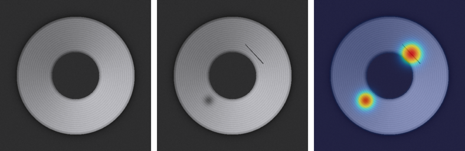
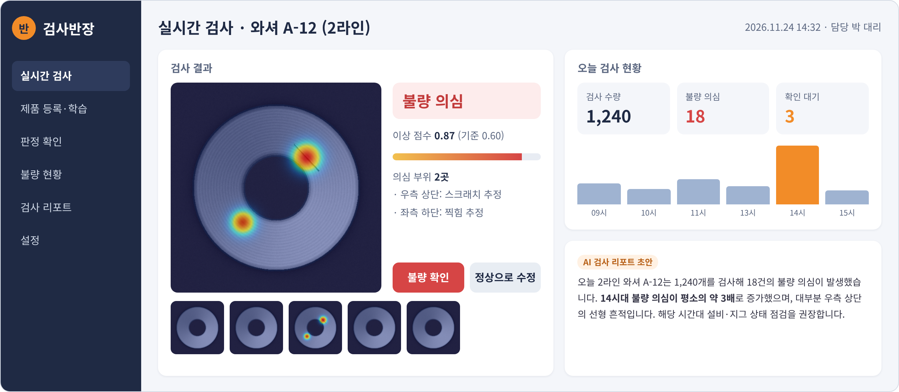
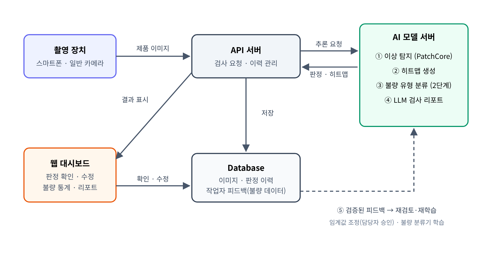

# 코디세이 팀프로젝트 - 검사반장

> **정상품 사진만으로 시작하는 중소 제조기업용 AI 품질검사 서비스**
>
> 경남 AI 올인원 1기 입학연수과정 Term-Project · 7개 도메인 아이디어톤 · **17조**

| 항목 | 내용 |
|---|---|
| 도메인 | AI Smart Factory |
| 팀명 | 검사반장 |
| 팀장 | 김보미 |
| 팀원 | 황재문, 박건영, 김지수, 김윤희 |
| 핵심 AI 기술 | 비지도 이상 탐지 (PatchCore) + LLM 검사 리포트 |
| 프로젝트 성격 | 서비스 기획 (개발 전 단계: 문제 정의 → AI 적용 → 서비스 설계 → 기대 효과) |

---

## 목차

1. [결과물 바로가기](#1-결과물-바로가기)
2. [한눈에 보기](#2-한눈에-보기)
3. [문제 정의](#3-문제-정의)
4. [타겟 사용자](#4-타겟-사용자)
5. [서비스 개요](#5-서비스-개요)
6. [AI 기술 적용](#6-ai-기술-적용)
7. [시스템 구성](#7-시스템-구성)
8. [기존 서비스 대비 차별점](#8-기존-서비스-대비-차별점)
9. [기대 효과](#9-기대-효과)
10. [향후 발전 방향](#10-향후-발전-방향)
11. [주제 선정 과정](#11-주제-선정-과정)
12. [팀 역할 분담](#12-팀-역할-분담)
13. [저장소 구조](#13-저장소-구조)
14. [참고 자료](#14-참고-자료)

---

## 1. 결과물 바로가기

| 구분 | 파일 | 설명 |
|---|---|---|
| **기획서 (제출본)** | [17조_기획서.pdf](01_기획서/17조_기획서.pdf) · [hwpx](01_기획서/17조_기획서.hwpx) | 과정에서 제공한 Term-Project 기획안 양식(2쪽, 한글에서 작성·저장) |
| 기획서 (상세본) | [검사반장_상세기획서.pdf](01_기획서/검사반장_상세기획서.pdf) · [docx](01_기획서/검사반장_상세기획서.docx) | 문제 정의부터 팀 역할까지 8개 항목을 자세히 담은 8쪽 문서 |
| **발표 자료** | [17조_발표자료.pdf](02_발표자료/17조_발표자료.pdf) · [pptx](02_발표자료/17조_발표자료.pptx) | 10쪽 발표 자료 (pptx에 발표자 노트 포함) |
| **발표 영상** | [17조_발표영상.mp4](03_발표영상/17조_발표영상.mp4) | 8분 25초 · 발표 + 팀원 역할 소개 |
| 학습노트 | [17조_학습노트.pdf](04_학습노트/17조_학습노트.pdf) · [html](04_학습노트/검사반장_학습노트.html) | 처음 보는 사람도 서비스를 이해할 수 있게 정리한 학습 자료 |
| 주제 선정 기록 | [주제선정_과정.md](05_주제선정/주제선정_과정.md) | 아이디어 14개 → 투표 → 세부 후보 8개 비교 → 보완 과정 |

> 🎥 GitHub 웹에서는 mp4가 바로 재생되지 않을 수 있습니다. 파일을 내려받아 재생해 주세요.

---

## 2. 한눈에 보기

**검사반장**은 공장에서 작업을 책임지고 챙기는 '반장'처럼, 현장 담당자 곁에서 품질검사를 맡아주는 AI 서비스입니다.

<p align="center">
  
</p>
<p align="center"><sub>① 정상품만 학습 → ② 새 제품 촬영 → ③ 정상과 다른 부위를 히트맵으로 표시 (설명용 합성 이미지)</sub></p>

| 질문 | 답 |
|---|---|
| 누구를 위한 서비스인가? | 육안검사에 의존하는 중소 제조기업의 품질 담당자·검사원 |
| 무엇이 문제인가? | AI 비전검사는 불량 이미지를 대량으로 학습해야 하는데, 공정이 안정된 현장일수록 불량 데이터가 부족함 |
| 어떻게 푸는가? | **정상품만 학습하는 이상 탐지 AI**로, 불량 데이터 없이 검사를 시작 |
| 무엇이 다른가? | 기술 자체가 아니라, 전문 엔지니어·전용 장비 없이 소기업이 직접 시작할 수 있는 **도입 방식** |

---

## 3. 문제 정의

### 3.1 배경

**① 중소 제조기업의 스마트화는 아직 초기 단계에 머물러 있다**

- 생산시설을 보유한 중소·중견기업 16만 3,273곳 중 스마트공장을 도입한 기업은 **19.5%**에 불과하며, 도입 기업의 **75.5%**도 가장 낮은 '기초 단계'에 머물러 있다.
- 규모별 도입률은 중견기업 85.7%, 중기업 54.2%, **소기업 28.5%, 소상공인 8.7%**로, 기업이 작을수록 도입률이 급격히 낮아진다.
  <sub>(중소벤처기업부 스마트공장 실태, 2023년 기준)</sub>

**② 품질검사는 사람의 눈에 의존할 가능성이 높다**

- 도입 기업의 대부분이 기초 단계라는 점을 고려하면, 품질검사 자동화까지 도달한 중소 제조 현장은 드물 것으로 판단된다.
- 육안검사는 검사원의 숙련도와 피로도에 따라 결과가 달라지고, 놓친 불량은 고객사 클레임과 반품으로 이어진다.

**③ AI 비전검사는 중소기업에게 높은 벽이다**

- 제조기업들은 AI 도입의 가장 큰 장벽으로 **초기 비용 부담**과 **전문 인력 부족**을 꼽는다. <sub>(대한상공회의소·중소기업중앙회 조사)</sub>
- 일반적인 AI 비전검사는 불량 이미지를 유형별로 대량 수집·라벨링해야 학습할 수 있지만, 공정이 안정된 현장일수록 불량이 드물어 데이터 확보 자체가 어렵다.

### 3.2 해결하고자 하는 문제

> **비용·전문 인력·불량 데이터가 부족해 육안검사에 머물러 있는 중소 제조기업이, 고가의 전용 장비나 전문 엔지니어 없이도 정상품 사진만으로 AI 품질검사를 시작할 수 있도록 지원한다.**

---

## 4. 타겟 사용자

| 구분 | 대상 | 주요 니즈 |
|---|---|---|
| **주 타겟** | 중소 제조기업(금속가공·사출·부품)의 품질 담당자·검사원 | 검사 피로·불량 누락 감소, 쉬운 사용법, 기존 공정 변경 없는 도입 |
| **구매 결정자** | 대표·공장장 | 낮은 초기 비용, 빠른 효과 확인, 클레임 감소 |
| **부 타겟** | 스마트공장 공급기업·SI 업체 | 고객사마다 반복되는 데이터 수집·세팅 기간 단축 |

**페르소나 (가설)**

> **박 대리 (38세, 직원 30명 규모 사출 부품 업체 품질 담당)**
> 하루 수천 개의 부품을 육안으로 검사한다. 오후가 되면 미세한 흠집을 놓치기 쉽다. AI 업체에 문의했다가 "불량 샘플 수천 장과 전용 장비가 필요하다"는 답을 듣고 포기했다.
> **원하는 것:** "지금 있는 정상품 사진으로 바로 써볼 수 있고, 왜 불량인지 눈으로 보여주는 도구"

<sub>※ 페르소나는 통계와 기존 솔루션의 도입 조건을 바탕으로 세운 가설이며, 현장 실증 단계에서 검증할 계획입니다.</sub>

---

## 5. 서비스 개요

### 5.1 사용 흐름

```
① 정상품 등록 → ② 모델 생성 → ③ 검사·히트맵 → ④ 작업자 확인 → ⑤ 현황·리포트
```

| 단계 | 기능 | 설명 |
|:-:|---|---|
| 1 | **정상품 등록** | 촬영 가이드에 따라 정상품 사진 수십~수백 장을 업로드 |
| 2 | **모델 생성** | 해당 제품 전용 이상 탐지 모델을 구성 |
| 3 | **검사와 히트맵** | 이상 점수로 불량 의심 여부를 판정하고, 의심 부위를 히트맵으로 표시 |
| 4 | **작업자 확인** | 작업자의 확인·수정 결과를 저장하고, 품질 담당자 승인 후 판정 기준(임계값)을 조정 |
| 5 | **현황·리포트** | 시간대·라인·제품별 불량 현황 대시보드, LLM 기반 검사 리포트 초안 자동 생성 |

> **촬영 조건:** 스마트폰·일반 카메라로 시작할 수 있지만, 조명·각도·거리·배경을 고정한 환경(간이 촬영대, 거치대)을 전제로 하는 초기 도입 방식입니다.

### 5.2 화면 예시

<p align="center">
  
</p>
<p align="center"><sub>실시간 검사 화면 목업 · 제품 이미지와 수치는 설명을 위한 합성 예시</sub></p>

---

## 6. AI 기술 적용

### 6.1 적용 기술

| 기능 | 적용 기술 | 설명 |
|---|---|---|
| 불량 검출 | **비지도 이상 탐지** (PatchCore) | 정상품 이미지의 특징을 학습하고, 새 이미지가 정상 분포에서 얼마나 벗어나는지 점수화 |
| 위치 표시 | 패치 단위 이상 점수 → 히트맵 | 영역별 이상 점수를 시각화해 판정 근거 제시 |
| 판정 기준 재검토 | 검증된 피드백 기반 임계값 조정 제안 | 시스템이 조정안을 제안하고 담당자 승인 후 적용 |
| 불량 유형 분류 (2단계) | 소량 학습 이미지 분류 | 축적된 불량 데이터로 스크래치·찍힘·오염 등 유형 분류 |
| 검사 리포트 | LLM | 정형화된 검사 데이터를 읽기 쉬운 한국어 보고서 초안으로 변환 |

### 6.2 기술 선택 이유

**왜 지도학습 분류가 아닌 이상 탐지인가**

| 구분 | 지도학습 (일반적인 분류 AI) | 이상 탐지 (검사반장) |
|---|---|---|
| 학습 데이터 | 정상 + 불량 이미지, 정답 라벨 필요 | **정상 이미지만** |
| 불량 데이터가 적을 때 | 성능이 크게 떨어짐 | **영향 없음** |
| 처음 보는 불량 | 학습한 적 없으면 놓침 | **정상과 다르면 검출** |

타겟 기업에는 바로 그 불량 데이터가 없기 때문에, **정상의 분포를 학습하고 그로부터 벗어난 것을 불량으로 판단하는** 이상 탐지 방식을 택했습니다.

**왜 PatchCore인가**

- 산업용 이상 탐지 공개 벤치마크 **MVTec AD**에서 이미지 단위 **AUROC 최대 99.6%**(기본 설정 약 99.1~99.2%)를 보고한 대표 기법입니다. <sub>(Roth et al., CVPR 2022)</sub>
- 신경망을 새로 학습하지 않고 사전학습 모델의 특징을 저장·비교하는 방식이라 학습이 빠르고, 제품마다 모델이 필요한 중소기업 환경에 적합합니다.
- 공식 구현 코드가 공개되어 있어 MVP 개발 부담이 적습니다.

> ⚠️ **성능 수치를 읽는 법**
> AUROC는 정상과 불량을 얼마나 잘 **구분**하는지 나타내는 지표(0.5 = 무작위, 1.0 = 완벽한 구분)입니다. "불량품 100개 중 99.6개를 검출한다"는 뜻이 아니며, 실제 검출률과 오검출률은 임계값 설정에 따라 달라집니다. 또한 논문의 벤치마크 결과이므로 **현장 성능은 실증을 통해 별도로 검증**해야 합니다.

**검증 데이터: MVTec AD**

- 15개 제품·텍스처 카테고리, 총 5,354장의 산업 이미지
- 학습용 데이터는 **모두 정상품**(카테고리당 60~391장) → "정상품 수십~수백 장으로 학습한다"는 검사반장의 사용 조건과 같음
- 비상업 라이선스(CC BY-NC-SA 4.0)이므로 MVP 검증·데모 용도로만 사용

### 6.3 한계와 대응 방안

| 한계 | 대응 방안 |
|---|---|
| 조명·배경·제품 위치가 바뀌면 오판 가능 | 촬영 가이드와 간이 촬영 지그로 촬영 환경 고정 |
| 정상/불량 판정 기준(임계값) 설정 필요 | 초기에는 정상 이미지의 이상 점수 분포로 보수적 기준을 설정하고, 검증된 피드백으로 주기적으로 재검토 |
| 작업자의 잘못된 피드백 | 품질 담당자가 검증한 데이터만 사용, 변경 이력 기록 및 이전 기준으로 되돌리기 가능 |
| 스크래치 같은 가는 선형 불량에 약함 | 축적된 불량 데이터로 2단계 분류기 추가 (이상 탐지 → 유형 분류) |
| 제품마다 별도 모델 필요 | 제품 등록 단위로 모델을 관리하는 구조로 설계 |

---

## 7. 시스템 구성

<p align="center">
  
</p>

**데이터 흐름**

1. **정상품 등록** — 현장 담당자가 촬영 가이드에 따라 정상품 사진을 업로드
2. **모델 학습** — AI 모델 서버가 제품별 이상 탐지 모델 생성
3. **검사** — 촬영 이미지에 대해 API 서버가 추론을 요청하고, 판정 결과와 히트맵을 대시보드에 표시
4. **작업자 확인** — 판정 확인·수정 결과를 데이터베이스에 저장
5. **기준 재검토와 재학습** — 검증된 피드백으로 임계값 조정안을 제안·승인하고, 불량 데이터가 충분해지면 불량 유형 분류기를 학습

→ **쓸수록 그 현장에 맞게 정확해지는 구조**

---

## 8. 기존 서비스 대비 차별점

정상품만으로 학습하는 이상 탐지 기술 자체는 Cognex(ViDi Red Analyze 비지도 모드), Landing AI(LandingLens 이상 탐지) 등 기존 상용 솔루션에서도 제공합니다. 검사반장의 차별점은 **기술이 아니라, 그 기술을 소기업 현장까지 가져가는 도입 방식**입니다.

| 구분 | 기존 상용 비전검사 솔루션 | 검사반장 |
|---|---|---|
| 정상품만으로 학습 | 가능 | 가능 |
| 주요 고객 | 중견·대기업, 전문 엔지니어 보유 기업 | **소기업·중기업의 현장 담당자** |
| 장비 | 전용 카메라·비전 시스템 중심 | **촬영 조건을 고정한 스마트폰·일반 카메라로 초기 도입** |
| 설정 방식 | 전문가가 데이터 분할·검증·임계값 조정 | **촬영 가이드 기반 단계별 설정** |
| 검증용 불량 샘플 | 학습·검증 단계에서 준비 권장 | **없이 시작, 작업자 확인으로 축적** |
| 결과 활용 | 판정 결과 중심 | **한국어 검사 리포트 + 불량 현황 대시보드** |

<sub>※ 각 솔루션의 공개 문서를 바탕으로 한 팀 분석입니다. 낮은 도입 비용과 간편한 설정이 실제로 달성되는지는 현장 실증에서 검증할 과제입니다.</sub>

> **"기술은 이미 검증되었다. 문제는 그 기술이 소기업 현장까지 오지 못한다는 것이다. 검사반장은 그 마지막 구간을 해결한다."**

---

## 9. 기대 효과

| 관점 | 기대 효과 |
|---|---|
| **사용자** | 검사 피로·불량 누락 감소, 히트맵으로 판정 근거 확인, 검사 일지 작성 시간 절감 |
| **비즈니스** | 불량 데이터 수집·전문가 세팅 부담 감소 → 기존 솔루션이 닿지 못한 소기업 시장 개척, 축적된 불량 데이터 기반 공정 개선 컨설팅 등 부가 서비스 확장 |
| **산업** | 기초 단계에 머문 중소 제조업 스마트공장의 실질적 고도화와 품질 경쟁력 향상 |

<sub>※ 정량 효과(검사 시간·불량 유출 감소율 등)는 근거 없이 제시하지 않고, 2단계 현장 실증에서 측정할 계획입니다.</sub>

---

## 10. 향후 발전 방향

| 단계 | 목표 | 주요 내용 |
|---|---|---|
| **1단계** MVP | 기술 검증 | MVTec AD로 검출 성능 검증, 웹 데모 (이미지 업로드 → 판정·히트맵) |
| **2단계** 현장 실증 | 사용성 검증 | 협력 기업 1~2곳 단일 제품 시범 운영, 검사 시간·불량 유출 효과 측정 |
| **3단계** 고도화 | 정확도·활용성 향상 | 불량 유형 분류, 공정 데이터 연동 불량 원인 분석 |
| **4단계** 확장 | 사업화 | 엣지 디바이스 탑재, 다품종·다라인 확대, 구독형(SaaS) 요금제 |

---

## 11. 주제 선정 과정

```
7개 도메인 × 2 = 아이디어 14개
        ↓  팀원 5명 1·2·3순위 투표 (3·2·1점)
AI Smart Factory 선정 (11점, 5명 중 4명 선택 / 2위 E-Commerce 6점)
        ↓  세부 후보 8개를 문제 근거·AI 필수성·차별화·자료 접근성으로 비교
불량 데이터가 부족한 현장의 AI 비전 품질검사 → '검사반장'
        ↓  검토를 거쳐 과장 표현 보완 (성능 수치 해석, 촬영 조건, 피드백 승인 구조 등)
최종 기획
```

자세한 투표 결과와 후보 비교표는 [05_주제선정/주제선정_과정.md](05_주제선정/주제선정_과정.md)에 정리했습니다.

---

## 12. 팀 역할 분담

| 이름 | 역할 | 담당 영역 및 기여 |
|---|---|---|
| **김보미** | 팀장 · PM · 발표 | 주제 선정 진행, 문제 정의·서비스 개요 작성, 기획서·발표 자료 작성, 발표 및 영상 제작 |
| **황재문** | 시장·산업 조사 | 배경의 산업 통계(스마트공장 도입 수준, AI 도입 장벽) 출처 검증 |
| **박건영** | 경쟁 분석 | 기존 상용 비전검사 솔루션 조사, 차별점 비교표 검토 |
| **김지수** | AI 기술 · 시스템 | 이상 탐지 기술(PatchCore, MVTec AD) 검토, 시스템 구성도 검토 |
| **김윤희** | 사용자 · 효과 | 타겟 사용자·페르소나 검토, 기대 효과·로드맵 검토 |

---

## 13. 저장소 구조

```
codyssey-teamproject-geomsabanjang/
├── README.md
├── 01_기획서/
│   ├── 17조_기획서.pdf            # 제출본 (과정 제공 양식, 2쪽)
│   ├── 17조_기획서.hwpx           # 제출본 한글 원본
│   ├── 검사반장_상세기획서.pdf     # 상세본 (8쪽)
│   └── 검사반장_상세기획서.docx
├── 02_발표자료/
│   ├── 17조_발표자료.pdf          # 제출본 (10쪽)
│   └── 17조_발표자료.pptx         # 발표자 노트 포함
├── 03_발표영상/
│   └── 17조_발표영상.mp4          # 8분 25초
├── 04_학습노트/
│   ├── 17조_학습노트.pdf
│   └── 검사반장_학습노트.html      # 브라우저로 열기
├── 05_주제선정/
│   └── 주제선정_과정.md
└── assets/                        # README 이미지
    ├── how_it_works.png
    ├── dashboard_mockup.png
    └── system_diagram.png
```

---

## 14. 참고 자료

**산업 통계**
- 중소벤처기업부, 스마트공장 도입 실태(2023년 기준) — [디지털데일리 보도](https://www.ddaily.co.kr/page/view/2025042816294926205)
- 중소벤처기업부, 2024년 기준 중소기업 기본통계 — [세계일보 보도](https://www.segye.com/newsView/20260109505471)
- 대한상공회의소, 제조기업 AI 활용 실태 조사 — [뉴데일리 보도](https://biz.newdaily.co.kr/site/data/html/2025/11/18/2025111800185.html)
- 중소기업중앙회, 중소제조업 AI 도입 실태 조사 — [뉴시스 보도](https://mobile.newsis.com/view/NISX20251017_0003367189)

**기술**
- Roth, K. et al. (2022). *Towards Total Recall in Industrial Anomaly Detection.* CVPR 2022. — [논문](https://openaccess.thecvf.com/content/CVPR2022/html/Roth_Towards_Total_Recall_in_Industrial_Anomaly_Detection_CVPR_2022_paper.html)
- Bergmann, P. et al. (2021). *The MVTec Anomaly Detection Dataset.* International Journal of Computer Vision. — [논문](https://link.springer.com/article/10.1007/s11263-020-01400-4) · [데이터셋](https://www.mvtec.com/company/research/datasets/mvtec-ad)

**기존 솔루션**
- Landing AI, LandingLens Anomaly Detection — [문서](https://landinglens.docs.landing.ai/anomaly-detection)
- Cognex, VisionPro Deep Learning(ViDi) Red Analyze Tool – Unsupervised Mode — [문서](https://docs.cognex.com/isvidi_131/web/EN/Help_ISViDi/Content/Topics/Overview/red-analyze-tool-unsupervised.htm)

---

<sub>본 저장소는 코디세이 경남 AI 올인원 1기 입학연수과정 Term-Project 결과물입니다. 문서와 화면에 쓰인 제품 이미지·검사 수치는 설명을 위한 합성 예시이며, 실제 기업이나 제품의 데이터가 아닙니다.</sub>
